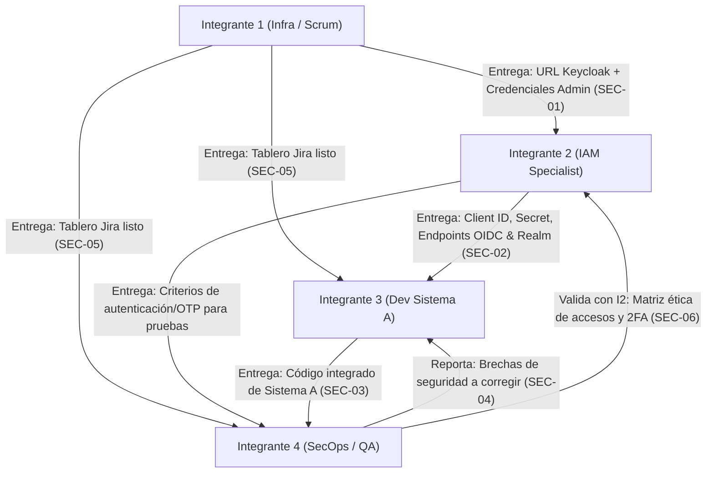
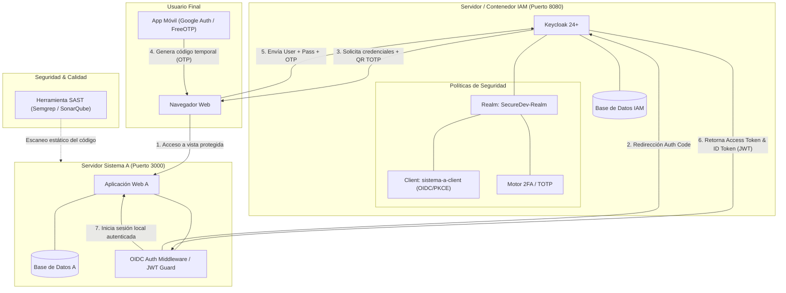
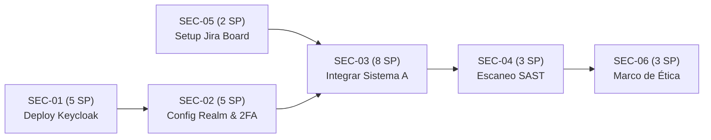
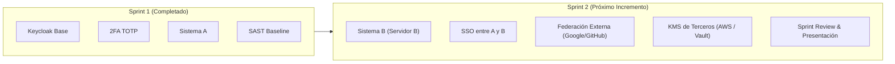

# 🛡️ Plan de Trabajo Ágil - Sprint 1: Integración de Seguridad, IAM y Sistema A
**Asignatura:** ISWZ3206 - Desarrollo de Software Seguro  
**Facultad:** Facultad de Ingeniería y Ciencias Aplicadas  
**Equipo:** 4 Integrantes  
**Objetivo del Sprint 1:** Puesta en marcha de la infraestructura de identidad con **Keycloak**, despliegue y protección del **Sistema A** (OIDC + 2FA TOTP), gestión ágil en **Jira** e integración de la herramienta de análisis estático (**SAST**).  
**Meta de Calificación:** 12.00 / 10.00 (10.00 base + 2.00 puntos extra por Keycloak y SAST).

---

> [!IMPORTANT]
> **Estrategia para Máxima Calificación (12/10):**
> 1. **Keycloak:** Se adopta como solución IAM principal para asegurar automáticamente los **200 puntos extras (+2 puntos sobre la nota final)**.
> 2. **SAST:** Se integra desde el Sprint 1 una herramienta de análisis estático (Semgrep/SonarQube) con reporte de brechas de seguridad (100 puntos adicionales).
> 3. **Gestión Ágil:** Tablero Jira con Epics, User Stories en formato INVEST/Gherkin y estimación por Story Points (100 puntos adicionales).

---

## 1. Matriz de Roles y Responsabilidades (RACI - 4 Integrantes)

| Integrante | Rol en el Equipo | Responsabilidad Principal | Tareas Clave en Sprint 1 |
| :--- | :--- | :--- | :--- |
| **Integrante 1** | **Scrum Master & Infra Lead** | Infraestructura & DevOps | Despliegue de Keycloak en contenedor/VM dedicada, gestión de redes, administración del tablero Jira. |
| **Integrante 2** | **IAM & Security Engineer** | Identidad y Acceso (IAM) | Configuración de Realm, Clientes OIDC, Roles RBAC, políticas de contraseñas y flujo de 2FA TOTP. |
| **Integrante 3** | **Software Engineer (Sistema A)** | Desarrollo de Aplicación | Adaptación del Sistema A, integración de middleware OIDC/JWT, redirección al login y gestión de sesión. |
| **Integrante 4** | **SecOps & QA Lead** | Seguridad Estática & Auditoría | Despliegue de SAST (Semgrep/SonarQube), remediación de brechas, casos de prueba y matriz de ética algorítmica. |

---

### 1.1. Matriz de Dependencias Cruzadas (¿Quién depende de quién?)



#### Detalle de Entregables y Bloqueos por Integrante:

1. **Integrante 2 DEPENDE de Integrante 1 (Bloqueante):**
   * *Entregable requerido:* Contenedor de Keycloak corriendo (`http://localhost:8080`) con acceso a la consola de administración.
   * *Impacto si se retrasa:* El Integrante 2 no puede crear el Realm, ni los Clientes OIDC, ni las políticas de 2FA.
   * *Mitigación:* Mientras tanto, Integrante 2 diseña el esquema de roles, nombres de scopes y políticas de contraseñas en papel/documentación.

2. **Integrante 3 DEPENDE de Integrante 2 (Bloqueante para el login real):**
   * *Entregable requerido:* `client-id` (`sistema-a-client`), `client-secret` (si aplica), y la URL del discovery endpoint (`/realms/SecureDev-Realm/.well-known/openid-configuration`).
   * *Impacto si se retrasa:* No se puede completar el flujo de redirección ni la validación del token JWT en el Sistema A.
   * *Mitigación:* El Integrante 3 puede avanzar en paralelo limpiando el código legacy del Sistema A, montando el servidor web local y dejando listos los stubs/placeholders del middleware.

3. **Integrante 4 DEPENDE de Integrante 3 (Bloqueante para el escaneo final):**
   * *Entregable requerido:* Repositorio del Sistema A con el middleware OIDC implementado.
   * *Impacto si se retrasa:* El análisis estático final (SAST) no incluirá el código de autenticación y manejo de sesión.
   * *Mitigación:* Integrante 4 puede ejecutar un escaneo SAST "baseline" previo sobre el código original del Sistema A para registrar vulnerabilidades heredadas y preparar las reglas de Semgrep/SonarQube.

4. **Integrante 3 DEPENDE de Integrante 4 (Bucle de remediación):**
   * *Entregable requerido:* Reporte de vulnerabilidades detectadas por SAST.
   * *Impacto:* Integrante 3 debe corregir los fallos marcados como High/Critical antes de dar la historia por terminada.

---

---

## 2. Arquitectura del Incremento (Sprint 1)



---

## 3. Product Backlog del Sprint 1 (Para importar en Jira)

### Parámetros del Sprint 1
* **Sprint Goal:** Desplegar y conectar el Sistema A con Keycloak en servidores separados, exigiendo autenticación OIDC con 2FA móvil obligatorio y con reporte SAST libre de fallos críticos.
* **Capacidad Estimada:** 26 Story Points (Fibonacci: 1, 2, 3, 5, 8).



---

### Detalle de Historias de Usuario

#### `SEC-01`: Despliegue de Servidor IAM con Keycloak en Contenedor Dedicado
* **Epic:** `EPIC-01: Gestión y Control de Identidades (IAM)`
* **Estimación:** 5 Story Points
* **Responsable:** Integrante 1 (Infra Lead)
* **Descripción:**  
  *Como* arquitecto de infraestructura,  
  *quiero* desplegar una instancia independiente de Keycloak en su propio entorno de red/puertos,  
  *para* centralizar la identidad de las aplicaciones y cumplir la primicia de servidores desacoplados.
* **Criterios de Aceptación (Gherkin):**
  ```gherkin
  Scenario: Despliegue y persistencia exitosa de Keycloak
    Given un host con Docker instalado
    When se ejecute el contenedor oficial de Keycloak con base de datos asociada
    Then la interfaz administrativa debe responder en http://localhost:8080/admin
    And las credenciales maestras deben configurarse de manera segura vía variables de entorno.
  ```

---

#### `SEC-02`: Creación del Realm, Cliente OIDC y Flujo 2FA (TOTP) Obligatorio
* **Epic:** `EPIC-01: Gestión y Control de Identidades (IAM)`
* **Estimación:** 5 Story Points
* **Responsable:** Integrante 2 (IAM Specialist)
* **Descripción:**  
  *Como* oficial de seguridad de la información,  
  *quiero* crear el Realm `SecureDev-Realm`, el cliente `sistema-a-client` y configurar el flujo condicional de OTP,  
  *para* exigir a todos los usuarios el segundo factor mediante una app móvil (Google Authenticator / FreeOTP).
* **Criterios de Aceptación (Gherkin):**
  ```gherkin
  Scenario: Enrolamiento obligatorio de OTP
    Given un usuario registrado en el Realm SecureDev-Realm
    When el usuario inicia sesión por primera vez con su usuario y contraseña
    Then Keycloak debe mostrar una pantalla con un código QR para enrolamiento TOTP
    And el usuario debe ingresar el código de 6 dígitos para finalizar el inicio de sesión.
  ```

---

#### `SEC-03`: Desarrollo/Adaptación del Sistema A con Middleware OIDC
* **Epic:** `EPIC-02: Sistema A (Aplicación Cliente Emisora)`
* **Estimación:** 8 Story Points
* **Responsable:** Integrante 3 (Software Engineer A)
* **Descripción:**  
  *Como* usuario del Sistema A,  
  *quiero* que la aplicación web delegue el login a Keycloak,  
  *para* ingresar mediante sesión única y acceder a las vistas protegidas según mis permisos.
* **Criterios de Aceptación (Gherkin):**
  ```gherkin
  Scenario: Redirección y validación de token JWT
    Given un usuario no autenticado que intenta entrar a http://localhost:3000/dashboard
    When la petición intercepta la ruta protegida
    Then es redirigido al formulario de autenticación de Keycloak
    And tras completar el login y 2FA, regresa al Sistema A con un token JWT válido
    And el Sistema A muestra la información del usuario y su rol.
  ```

---

#### `SEC-04`: Integración y Ejecución de Análisis Estático de Código (SAST)
* **Epic:** `EPIC-05: Seguridad y Cumplimiento`
* **Estimación:** 3 Story Points
* **Responsable:** Integrante 4 (SecOps & QA Lead)
* **Descripción:**  
  *Como* auditor de seguridad de software,  
  *quiero* ejecutar una herramienta de análisis estático (Semgrep / SonarQube) sobre el código fuente del Sistema A,  
  *para* detectar y subsanar brechas de seguridad (OWASP Top 10) antes de la entrega del sprint.
* **Criterios de Aceptación (Gherkin):**
  ```gherkin
  Scenario: Escaneo SAST y remediación de vulnerabilidades críticas
    Given el repositorio del Sistema A configurado con la herramienta SAST
    When se ejecute el escaneo estático automatizado
    Then se genera un reporte estructurado con los hallazgos
    And no deben existir vulnerabilidades sin mitigar de categoría 'Critical' o 'High' (ej. Hardcoded Secrets, Injection).
  ```

---

#### `SEC-05`: Gestión del Proyecto y Configuración del Tablero en Jira
* **Epic:** `EPIC-05: Seguridad y Cumplimiento`
* **Estimación:** 2 Story Points
* **Responsable:** Integrante 1 (Scrum Master)
* **Descripción:**  
  *Como* evaluador del proyecto,  
  *quiero* inspeccionar el tablero Scrum en Jira con sus historias, estimaciones y evidencias,  
  *para* validar el esquema ágil exigido en los puntos adicionales (+100 puntos).
* **Criterios de Aceptación:**
  - Tablero de tipo Scrum configurado en Jira con columnas: *To Do*, *In Progress*, *Code Review/Security Check*, *Done*.
  - 100% de las historias del Sprint 1 vinculadas a sus respectivas Epics.
  - Registro de tiempos o avance de estado con capturas de pantalla adjuntas como evidencia.

---

#### `SEC-06`: Formulación de la Matriz de Ética Algorítmica y No Discriminación
* **Epic:** `EPIC-05: Seguridad y Cumplimiento`
* **Estimación:** 3 Story Points
* **Responsable:** Integrante 4 con Integrante 2
* **Descripción:**  
  *Como* equipo de desarrollo ético,  
  *quiero* documentar el impacto ético de los mecanismos de autenticación y autorización implementados,  
  *para* asegurar que la solución no imponga barreras arbitrarias ni discrimine a los usuarios finales.
* **Criterios de Aceptación:**
  - Documento inicial que analiza:
    1. **Inclusión y accesibilidad:** Mecanismos de recuperación ante pérdida del dispositivo móvil (evitar bloqueo permanente).
    2. **Minimización de datos (GDPR / Privacidad):** El token OIDC expone únicamente los claims estrictamente necesarios (`sub`, `email`, `roles`).
    3. **Imparcialidad:** Políticas de bloqueo por fuerza bruta configuradas con ventanas de tiempo razonables para evitar exclusión involuntaria.

---

## 4. Guía Rápida de Configuración Técnica

### 4.1. Despliegue de Keycloak con Docker Compose (`docker-compose.yml`)
> [!TIP]
> Este archivo levanta Keycloak 24+ en modo desarrollo en el puerto `8080`, listo para integrarse:

```yaml
version: '3.8'

services:
  keycloak:
    image: quay.io/keycloak/keycloak:latest
    container_name: keycloak-iam
    command: start-dev
    environment:
      - KEYCLOAK_ADMIN=admin
      - KEYCLOAK_ADMIN_PASSWORD=AdminSecurePass2026!
      - KC_HTTP_PORT=8080
    ports:
      - "8080:8080"
    volumes:
      - keycloak_data:/opt/keycloak/data

volumes:
  keycloak_data:
```

### 4.2. Pasos de Configuración en Keycloak Admin Console
1. **Crear Realm:** Crear `SecureDev-Realm`.
2. **Crear Cliente para Sistema A:**
   - **Client ID:** `sistema-a-client`
   - **Client Protocol:** `openid-connect`
   - **Access Type / Client Authentication:** `Public` (si es SPA/Frontend) o `Confidential` (si es backend con client secret).
   - **Valid Redirect URIs:** `http://localhost:3000/*` (o la IP/puerto del Sistema A).
   - **Web Origins:** `*` o `http://localhost:3000`.
3. **Configurar 2FA (OTP):**
   - En `Authentication` ➔ `Required Actions` ➔ Asegurarse de que `Configure OTP` esté habilitado.
   - En `Authentication` ➔ `Policies` ➔ `OTP Policy`: Tipo TOTP, Algoritmo SHA1, 6 dígitos, periodo 30s.

### 4.3. Escaneo SAST con Semgrep (Rápido y Efectivo)
```bash
# Instalación rápida
pip install semgrep

# Escaneo enfocado en OWASP Top 10 y buenas prácticas de seguridad
semgrep scan --config auto --output=sast-report.json --json
```

---

## 5. Definition of Done (DoD) - Cierre de Sprint 1

Para dar por concluido el Sprint 1:
- [ ] Keycloak ejecuta en su propio entorno y responde en el puerto `8080`.
- [ ] El Realm `SecureDev-Realm` y el Cliente `sistema-a-client` están activos.
- [ ] El Sistema A está desplegado en un host/puerto distinto (ej. `3000`) con su propia base de datos.
- [ ] Flujo de autenticación completo probado: Login ➔ Escaneo de QR TOTP ➔ Ingreso exitoso al Sistema A.
- [ ] Escaneo SAST ejecutado sin alertas de severidad Crítica o Alta.
- [ ] Tablero de Jira con historias completadas en estado `Done` y capturas de evidencia adjuntas.

---

## 6. Hoja de Ruta para el Sprint 2 (Integración Total y KMS)


